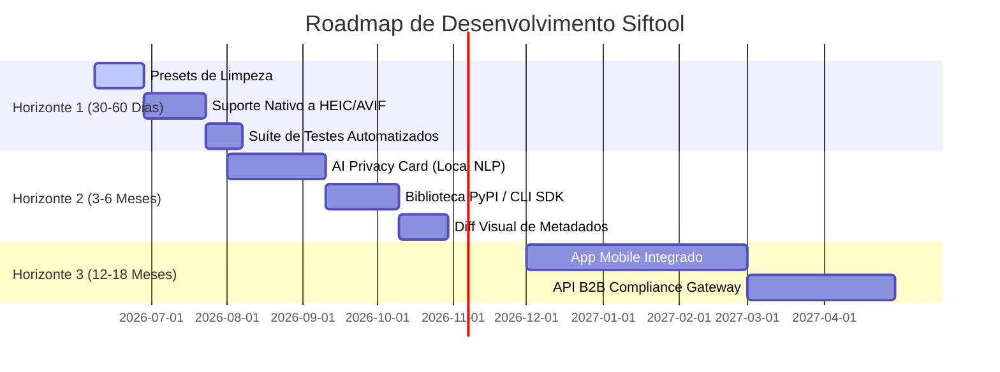

# Análise Competitiva Estratégica — Siftool (ex-exifcleaner)

> Documento de Estratégia de Produto · Junho/2026
> Autor: Estrategista de Produto de Elite (AI & DevTools)
> Foco: Posicionar o Siftool como o padrão-ouro de sanitização de imagens para desenvolvedores, criadores e entusiastas de privacidade.

---

## 1. Diagnóstico Brutal: Onde Estamos Hoje?

O projeto passou por uma evolução técnica significativa nos últimos marcos. Saímos de um "exercício de uma imagem" lento e destrutivo (que re-encodava JPEG degradando pixels) para uma ferramenta estruturada:

### O Que Já Foi Conquistado (Horizonte 1 e 2 concluídos)
* **Renomeação Estratégica:** O projeto foi renomeado de *exifcleaner* para **Siftool** (v1.0.0), eliminando conflitos de marca/SEO e estabelecendo uma identidade própria de "peneirar/sift" metadados.
* **Processamento em Lote Real:** Implementado com fila em multithreading (`FileRow`), fila assíncrona (`queue.Queue`) e poller de eventos (80ms).
* **Limpeza Lossless de Verdade (Byte-Level/Chunk-Level):**
  * **JPEG:** Criado um parser binário customizado (`JpegCleaner`) que stripa segmentos de metadados (`APP0..APP15`, `COM`, etc.) no nível de bytes, **sem tocar nos pixels**.
  * **PNG:** Criado um parser chunk-by-chunk (`PngCleaner`) que mantém apenas os chunks vitais (`IHDR`, `IDAT`, `IEND`, `PLTE`, `tRNS`, `pHYs`) e descarta chunks de metadados e C2PA (`caBX`, `cPRV`).
  * **WEBP/GIF/TIFF:** Limpeza inteligente sem perda via PIL.
* **Selo "Verified Clean" (Verificação Ativa):** O app agora realiza uma varredura pós-limpeza para certificar que o arquivo de saída realmente tem zero metadados sensíveis residuais.
* **Pioneirismo em C2PA (Content Credentials):** Detecção nativa, explicação visual clara e remoção de metadados assinados (proveniência criptográfica) em JPEG, PNG e WebP.
* **Integração Nativa:** Integração direta com o menu de contexto do Windows Explorer via chaves no Registro do Windows (`winreg`).
* **Interface Premium:** Visual "Espelho do Universo" (dark cósmico, roxo neon, glassmorphism) e layout com scroll unificado de alta performance.
* **Dev-Ready:** Núcleo desacoplado com CLI estruturado (subcomandos `scan`, `clean`, `verify`, `register-context`).

### A Nova Lacuna: O Próximo Nível (Fase de IA e Dev-Enablement)
Agora que o Siftool se igualou tecnicamente aos melhores limpadores offline, o desafio é: **como ir 10x além e se destacar em um mercado saturado de utilitários gratuitos?** 
A resposta está em transformar o Siftool no **primeiro Hub AI-Native de Privacidade e Sanitização de Imagens para Desenvolvedores e Criadores**.

---

## 2. Mapeamento Competitivo (Top 10)

Análise aprofundada dos concorrentes diretos e indiretos no mercado global de remoção de metadados e privacidade de imagem em 2026.

### 2.1 ExifCleaner (szTheory) — *O Concorrente Direto nº 1*
* **Pontos fortes:** Marca forte (exifcleaner.com), open-source, GUI amigável com drag-and-drop, processamento em lote rápido por usar ExifTool como subprocesso.
* **Pontos fracos:** **Abandonado há mais de 2 anos.** Desenvolvido em **Electron** (consome ~200MB de RAM parado, gerando issues de uso abusivo de CPU por helpers em background). Histórico documentado de corromper arquivos RAW e falhas de compilação em macOS/Linux.
* **Diferenciais:** Simplicidade radical de arrastar e soltar.
* **UX/UI:** Limpa, mas pesada. Tema escuro estático básico.
* **IA/Integrações:** Zero IA. Integração apenas por drag-and-drop.
* **Estratégia de Monetização:** 100% gratuito. Sem iscas comerciais.
* **➡️ Oportunidade para Siftool:** Apresentar-se como "O sucessor leve, ativamente mantido e seguro por construção (sem Electron)".

### 2.2 ExifTool (Phil Harvey) — *O Padrão-Ouro Técnico*
* **Pontos fortes:** A ferramenta mais robusta, atualizada e completa do mundo. Suporta mais de 200 formats de arquivo. Não altera pixels (lossless nativo). Usada como "motor" por 90% dos concorrentes.
* **Pontos fracos:** Interface **exclusiva de CLI/Terminal**. Extremamente intimidadora para usuários comuns. Curva de aprendizado íngreme.
* **Diferenciais:** Cobertura de metadados proprietários (maker notes de todas as marcas de câmera).
* **UX/UI:** Nula (linha de comando).
* **IA/Integrações:** Zero IA. Integração rica via Perl/CLI.
* **Estratégia de Monetização:** Doações. Livre para uso comercial.
* **➡️ Oportunidade para Siftool:** Embrulhar esse poder em uma GUI ultra-premium e fornecer APIs em Python fáceis de integrar.

### 2.3 MAT2 (Metadata Anonymisation Toolkit 2) — *O Queridinho do Linux/Tor*
* **Pontos fortes:** Foco extremo em segurança e privacidade. Adotado por distros focadas em anonimato (Tails, Whonix). Suporta não apenas imagens, mas PDF, DOCX, ZIP, MP3, etc.
* **Pontos fracos:** Focado em Linux. Integração com Windows é complexa. Interface gráfica oficial (Kleaner) é rudimentar e difícil de instalar no ecossistema Microsoft.
* **Diferenciais:** Remoção profunda de assinaturas de arquivos complexos (ZIP, PDF).
* **UX/UI:** Interface Linux GTK muito simples.
* **IA/Integrações:** Zero IA.
* **➡️ Oportunidade para Siftool:** Dominar o ecossistema Windows/Dev com o Siftool, oferecendo a mesma seriedade de anonimização com uma UX infinitamente superior.

### 2.4 EXIF Purge — *O Utilitário Simples do Windows*
* **Pontos fortes:** Portátil, minúsculo, processamento em lote rápido.
* **Pontos fracos:** Interface visual que parece ter parado em 2010. Focado apenas em imagens JPEG. Não exibe quais metadados estão sendo limpos (caixa preta).
* **Diferenciais:** Sem instalação.
* **UX/UI:** Datada, caixas de diálogo padrão do Windows.
* **Estratégia de Monetização:** Grátis, sustentado por anúncios/redirecionamentos no site oficial.
* **➡️ Oportunidade para Siftool:** Atrair usuários insatisfeitos com a falta de suporte a formatos modernos (PNG/WEBP/C2PA) e design obsoleto.

### 2.5 Windows Nativo (Propriedades → Remover Informações Pessoais)
* **Pontos fortes:** Já está no SO. Zero instalação.
* **Pontos fracos:** **Falha Silenciosa.** O Windows diz que removeu, mas frequentemente deixa rastros de lens profiles, câmera, timestamps de criação e metadados de software. Não suporta PNG de forma confiável para dados de câmera.
* **Diferenciais:** Integração nativa no File Explorer.
* **UX/UI:** Padrão do Windows.
* **➡️ Oportunidade para Siftool:** Mostrar ao usuário que o nativo falha. O Siftool lê e prova que sobrou dados com o selo "Verified Clean".

### 2.6 Scrambled Exif (Android)
* **Pontos fortes:** Integração perfeita no menu "Compartilhar" do Android. Você limpa o arquivo no ato do envio.
* **Pontos fracos:** Apenas para Android. Suporte limitado a JPEG.
* **➡️ Oportunidade para Siftool:** Criar a versão mobile do Siftool com o mesmo fluxo integrado no compartilhamento de mídias do celular.

### 2.7 AI Metadata Cleaner (Entrante Web)
* **Pontos fortes:** Posicionamento de marketing agressivo usando o termo "IA". Moderno.
* **Pontos fracos:** Na realidade, **não usa IA** para a remoção (IA-washing). Limites de uso na versão web grátis. Risco de privacidade (arquivos enviados para servidores).
* **➡️ Oportunidade para Siftool:** Oferecer IA real (local e privada) que analisa semanticamente o contexto das tags para orientar a remoção, em vez de apenas marketing.

### 2.8 Editores de Imagem (Photoshop / GIMP)
* **Pontos fortes:** Controle milimétrico das opções de exportação ("Save for Web").
* **Pontos fracos:** Bazuca para matar formiga. Abrir um software de 2GB apenas para remover tags de geolocalização é ineficiente.
* **➡️ Oportunidade para Siftool:** Agilidade. Siftool abre em menos de 1 segundo e executa em lote.

---

## 3. Análise de Mercado (2025–2026)

### 3.1 Tendências Atuais
1. **Proliferação da IA Generativa e RAG Pipelines:** Desenvolvedores estão enviando milhões de imagens de usuários para modelos de IA (OpenAI, Gemini, Claude) em sistemas de chat e RAG. Se as imagens não forem limpas, os modelos extraem dados de geolocalização e histórico de edição, criando um **vazamento massivo de privacidade corporativa e conformidade (LGPD/GDPR)**.
2. **C2PA / Content Credentials em Larga Escala:** A proveniência de imagens virou padrão. Fotos tiradas em celulares topo de linha ou geradas por IA trazem assinaturas criptográficas complexas. Criadores que querem postar conteúdo sob pseudônimo precisam stripá-las sem corromper os arquivos.
3. **Ascensão de Apps Leves:** Desenvolvedores cansados de aplicativos pesados em Electron preferem ferramentas nativas, de alta performance e eficientes em memória.
4. **Privacidade Mainstream:** Geolocalização de fotos compartilhadas em redes sociais/mensageiros está sendo usada para stalking corporativo e pessoal.

### 3.2 Oportunidades de Disrupção
* **Sanitização de RAG / AI Agent Pipelines:** Criar o Siftool SDK que impede que agentes de IA leiam metadados confidenciais de arquivos enviados por clientes.
* **Diagnóstico Semântico por IA:** Explicar ao usuário comum, em linguagem natural, qual o risco real daquela imagem ("Esta foto revela o endereço residencial X tirada às 14h de uma terça-feira").
* **Log de Conformidade para Empresas:** Provar que todos os uploads de imagens em um sistema foram limpos e auditados.

---

## 4. Matriz de Competitividade

| Feature / Capacidade | Siftool (Atual) | ExifCleaner (Electron) | ExifTool | EXIF Purge | Windows Nativo | Oportunidade de Diferenciação do Siftool |
|---|---|---|---|---|---|---|
| **Processamento em Lote** | ✅ (Threaded) | ✅ | ✅ (CLI) | ✅ | 🟡 (Seleção) | Execução nativa ultrarápida sem travar o SO. |
| **Limpeza Lossless (Byte-level)** | ✅ | ✅ | ✅ | 🟡 | ✅ | Siftool usa parsing próprio super leve. |
| **Arrastar e Soltar (Drag & Drop)** | ✅ | ✅ | ❌ | ✅ | n/a | Integrado ao visual premium dark. |
| **Selo "Verified Clean"** | ✅ | ❌ | ❌ | ❌ | ❌ | **Exclusivo Siftool:** Prova matemática de remoção. |
| **Detecção / Remoção C2PA** | ✅ | ❌ | 🟡 | ❌ | ❌ | **Exclusivo Siftool:** Explicação e remoção de assinaturas de IA. |
| **Integração Windows Explorer** | ✅ | ❌ | ❌ | ❌ | ✅ | Limpeza direta via botão direito do mouse. |
| **Dev CLI & Automação** | ✅ | ❌ | ✅ | ❌ | ❌ | Siftool CLI pronto para pipelines CI/CD. |
| **Diagnóstico de Risco por IA** | ❌ | ❌ | ❌ | ❌ | ❌ | **🎯 Espaço Livre:** Traduzir EXIF para avisos de risco de privacidade. |
| **Biblioteca / Python SDK** | 🟡 (Local) | ❌ | ❌ | ❌ | ❌ | **🎯 Espaço Livre:** `pip install siftool` para automatizar backends. |
| **Multiplataforma** | 🟡 (Win/Py) | ✅ | ✅ | 🟡 | ❌ | Compilar builds nativas prontas para Linux/macOS. |
| **Leveza (RAM / Startup)** | ✅ (~25MB) | ❌ (~200MB) | ✅ | ✅ | ✅ | Tkinter customizado de alta performance. |

---

## 5. Estratégia de Produto Recomendada

### Fase 1: Parity (Empate/Consolidação) — *Onde estamos empatando ou liderando*
* **HEIC/HEIF & AVIF Lossless:** O iPhone usa HEIC por padrão. O Android está adotando AVIF. Precisamos adicionar suporte a limpeza sem perda para estes formatos.
* **Perfis de Limpeza (Presets):**
  * *Modo Paranoico:* Stripa 100% de metadados, incluindo cores e profiles (máxima privacidade).
  * *Modo Fotógrafo:* Remove GPS e autoria pessoal, mas mantém perfil ICC de cor, exposição da câmera (F-stop, ISO) e dimensões.
  * *Modo Web/Redes Sociais:* Remove C2PA e GPS, otimizando para uploads.

### Fase 2: Differentiation (Diferenciação 10x) — *Onde nos tornamos claramente superiores*
* **AI Privacy Card (Diagnóstico Semântico):**
  * Integrar um parser semântico leve (utilizando LLM local ou via API segura) no painel lateral.
  * Traduzir metadados criptografados em alertas legíveis: *"Aviso: Esta foto foi tirada a 50 metros da escola X, usando um iPhone 15 Pro, e foi editada no Adobe Lightroom."*
* **SDK de Sanitização para Agentes de IA (Siftool DevLink):**
  * Publicar a engine como um pacote PyPI: `pip install siftool`.
  * Fornecer decorações prontas para LangChain, LlamaIndex e LangGraph: limpar imagens automaticamente antes que o LLM as processe, prevenindo injeções de dados ou vazamento de privacidade.
* **Diff Visual de Metadados:**
  * Exibição visual lado a lado em tempo real do arquivo original vs. arquivo limpo.

### Fase 3: Domination (Domínio e Moats) — *A barreiras defensivas do produto*
* **Engine Lossless Binária Híbrida:** Aprimorar o motor em C/Rust para máxima velocidade, empacotando-o como uma biblioteca nativa que roda em qualquer SO.
* **Selo Criptográfico de Anonimização:** Gerar uma hash SHA256 do arquivo limpo e assinar digitalmente um log/recibo de que o arquivo passou pela esteira Siftool e está livre de PII (Personally Identifiable Information). Ideal para compliance corporativo.
* **Foco em Compliance de Uploads (B2B SaaS API):** Oferecer uma versão corporativa (API gateway) que limpa gigabytes de upload por segundo de clientes em portais bancários ou de saúde, onde a privacidade de imagens é regulada por lei.

---

## 6. Roadmap Priorizado

### Horizonte 1 — Próximos 30-60 dias (MVP Competitivo & Estabilização)

* **Presets/Perfis de Limpeza**
  * **Prioridade:** Crítica
  * **Impacto:** Alto
  * **Esforço:** Baixo
  * **Justificativa:** Permite que fotógrafos usem o app sem medo de perder perfis de cores da imagem, ampliando a base de usuários para além dos entusiastas de privacidade pura.
* **Suporte Nativo a HEIC/AVIF**
  * **Prioridade:** Alta
  * **Impacto:** Muito Alto
  * **Esforço:** Médio
  * **Justificativa:** Celulares modernos salvam mídias nesses formatos. Sem suporte nativo, o app fica obsoleto para fotos de iPhone.
* **Suíte de Testes Automatizados (CI/CD)**
  * **Prioridade:** Alta
  * **Impacto:** Médio
  * **Esforço:** Médio
  * **Justificativa:** Garante que novos patches na engine lossless não corrompam cabeçalhos binários complexos. Vital para o portfólio do desenvolvedor.

### Horizonte 2 — Próximos 3-6 meses (Diferenciação com IA & SDK)

* **AI Privacy Card (Local NLP/AI Detector)**
  * **Prioridade:** Alta
  * **Impacto:** Muito Alto
  * **Esforço:** Alto
  * **Justificativa:** Fornece o fator "Uau" na interface e educa o usuário sobre o perigo real dos metadados da imagem, justificando o posicionamento moderno do app.
* **Biblioteca PyPI (Siftool SDK)**
  * **Prioridade:** Alta
  * **Impacto:** Muito Alto
  * **Esforço:** Médio
  * **Justificativa:** Facilita a integração do motor de limpeza em aplicações corporativas e agentes de inteligência artificial. Mostra maturidade arquitetônica para recrutadores.
* **Diff Visual de Metadados**
  * **Prioridade:** Média
  * **Impacto:** Médio
  * **Esforço:** Médio
  * **Justificativa:** Melhora drasticamente a experiência emocional do aplicativo, deixando claro exatamente o que foi deletado do arquivo.

### Horizonte 3 — Visão de 12-18 meses (Domínio de Ecossistema)

* **App Mobile Integrado (Android/iOS Share Menu)**
  * **Prioridade:** Média
  * **Impacto:** Alto
  * **Esforço:** Alto
  * **Justificativa:** O verdadeiro compartilhamento de fotos acontece no celular. Um app móvel atinge uma escala 20x maior do que o desktop.
* **API B2B Compliance Gateway**
  * **Prioridade:** Média
  * **Impacto:** Alto
  * **Esforço:** Alto
  * **Justificativa:** Possibilita monetizar o projeto com assinaturas enterprise para empresas que precisam limpar uploads de fotos de documentos (RG/CNH) em conformidade com leis de proteção de dados.

---

## 7. Recomendações de Posicionamento e Mensagem

### 7.1 Messaging & Pitch
* **Posicionamento Principal:** *"Siftool — O primeiro higienizador de imagens local, ultraleve e inteligente."*
* **Mensagens-chave:**
  * **Privacidade Local Absoluta:** *"100% offline. Suas mídias nunca saem da sua máquina."*
  * **Engine Lossless:** *"Nenhum pixel é alterado. Removemos apenas a assinatura digital, mantendo a qualidade original impecável."*
  * **Zero Complicação:** *"Lote, menu de contexto e CLI. Integre no seu fluxo diário com facilidade."*

### 7.2 Métricas de Sucesso (KPIs)
* **Downloads e Releases:** Acompanhar instalações no GitHub e downloads do `.exe` compilado.
* **Integridade da Engine:** Taxa de rejeição pós-limpeza (quantos arquivos passaram no scanner e mantiveram o selo "Verified Clean").
* **Atração B2B/Devs:** Estrelas no GitHub e instalações do CLI/SDK por desenvolvedores em busca de soluções para pipelines de imagens.
