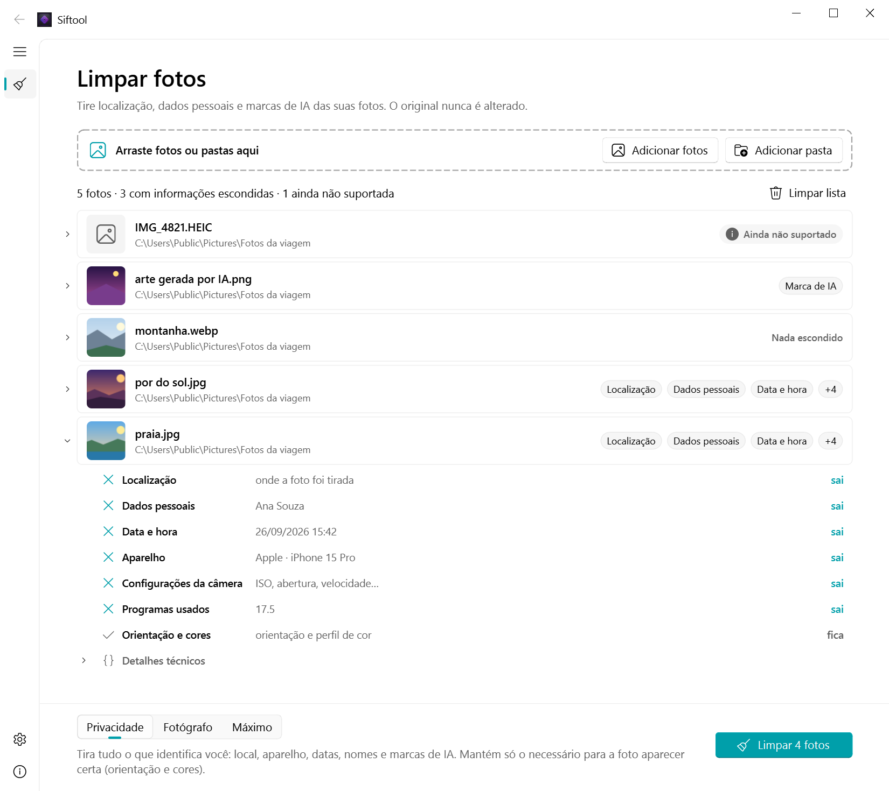
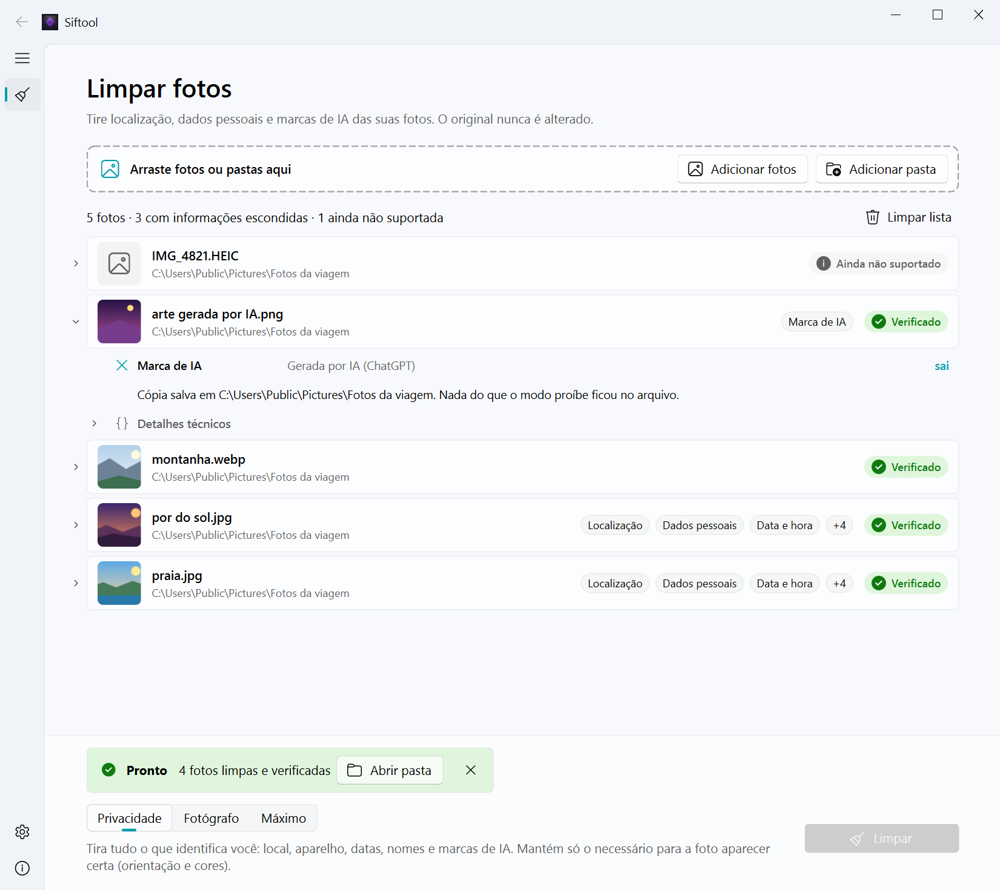
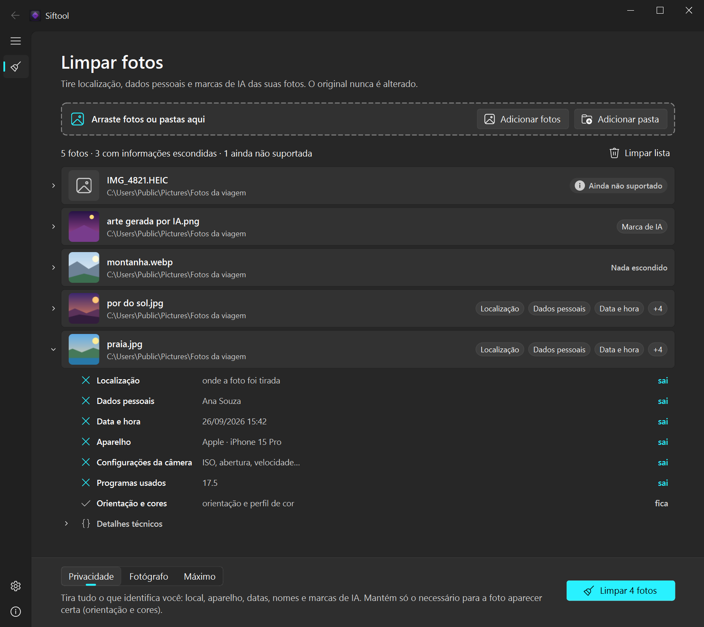

<div align="center">
  

  <h1>Siftool</h1>

  <p><b>Tire localização, dados pessoais e marcas de IA das suas fotos, sem perder qualidade.</b><br>
  100% offline · o original nunca é alterado · selo só quando a limpeza é verificada</p>

  [](https://github.com/FFloriani/siftool/releases)
  [](https://github.com/FFloriani/siftool/releases)
  [](https://github.com/FFloriani/siftool/releases)
  [](LICENSE)
  [](https://buymeacoffee.com/1b9hbqniv1)

  <p>
    <a href="https://github.com/FFloriani/siftool/releases/download/v2.0.0-beta.1/Siftool-2.0.0-beta.1-setup.exe"><b>⬇ Baixar o instalador</b></a> (22 MB)
    &nbsp;·&nbsp;
    <a href="https://github.com/FFloriani/siftool/releases/download/v2.0.0-beta.1/Siftool-2.0.0-beta.1-portable.zip"><b>⬇ Baixar a versão portátil</b></a> (27 MB)
    &nbsp;·&nbsp;
    <a href="https://github.com/FFloriani/siftool/releases">Todas as versões</a>
  </p>

  
</div>

---

## O que é

Toda foto carrega informações escondidas além da imagem: **onde** foi tirada (GPS), **quando**, com **qual celular ou câmera**, o **seu nome**, o **programa** que a editou e, nas imagens feitas por IA, uma **marca de procedência** (C2PA / Content Credentials) que diz que foi o ChatGPT, o Gemini ou outro gerador.

O Siftool mostra o que cada foto esconde, em português claro, e grava uma **cópia limpa** ao lado do original:

- **Sem perder qualidade.** Ele não recomprime a imagem: copia os bytes da foto exatamente como estão e tira só os blocos de metadados. Os pixels saem idênticos.
- **O original nunca é alterado.** A cópia sai como `foto_clean.jpg`. Nada é sobrescrito.
- **Selo só quando é verdade.** Depois de gravar, o Siftool relê a cópia do zero e confere que nada do que o modo proíbe ficou lá. Se sobrou alguma coisa, a cópia não é salva e ele diz o motivo.
- **100% offline.** Sem internet, sem telemetria, sem conta. As fotos nunca saem do seu computador.

## Baixar e instalar

Precisa de **Windows 10 ou 11 (64 bits)**. Não precisa instalar Python nem nada mais.

| | Como funciona |
|---|---|
| **Instalador** · [`Siftool-2.0.0-beta.1-setup.exe`](https://github.com/FFloriani/siftool/releases/download/v2.0.0-beta.1/Siftool-2.0.0-beta.1-setup.exe) | Instala só para o seu usuário, **sem pedir senha de administrador**. Cria o atalho no menu Iniciar e, se você deixar marcado, põe **Limpar com Siftool** no clique direito das fotos e das pastas. Para remover: Configurações → Aplicativos → Siftool → Desinstalar. |
| **Portátil** · [`Siftool-2.0.0-beta.1-portable.zip`](https://github.com/FFloriani/siftool/releases/download/v2.0.0-beta.1/Siftool-2.0.0-beta.1-portable.zip) | Não instala nada. Extraia a pasta `Siftool` num caminho **curto** (como `C:\Siftool` ou um pendrive) e abra o `Siftool.exe`. As configurações ficam dentro da própria pasta. Para remover, apague a pasta. |

> [!NOTE]
> **"O Windows protegeu o computador"**: o Siftool ainda não tem assinatura digital, então na primeira vez o Windows mostra esse aviso. Clique em **Mais informações** → **Executar assim mesmo**. Com o *Controle inteligente de aplicativos* do Windows 11 ligado, o Windows pode bloquear programas sem assinatura sem oferecer essa opção.

<details>
<summary>Mais detalhes sobre a instalação</summary>

- O instalador grava em `%LOCALAPPDATA%\Programs\Siftool`. As configurações ficam em `%APPDATA%\Siftool` e continuam lá depois de desinstalar.
- No Windows 11, **Limpar com Siftool** aparece em **Mostrar mais opções** no clique direito. O Windows esconde esse item quando mais de 15 arquivos estão selecionados: para muitas fotos, use o item da pasta ou arraste as fotos para a janela.
- Na versão portátil, o caminho completo da pasta precisa ser curto: com cerca de 200 caracteres ou mais (pastas muito fundas, como as do OneDrive), o programa não abre. Num pendrive protegido contra gravação ele funciona, mas avisa que não consegue salvar as configurações.
- Abrir várias fotos pelo clique direito manda todas para a mesma janela; o Siftool não abre uma janela por foto.
- Os códigos SHA-256 dos arquivos estão na [página da versão](https://github.com/FFloriani/siftool/releases/tag/v2.0.0-beta.1).

</details>

## Como usar

1. **Arraste** fotos ou pastas para a janela (ou use **Adicionar fotos** / **Adicionar pasta**, ou o clique direito do Windows).
2. **Veja** o que cada foto esconde. Clique numa foto para ver os detalhes: o que **sai** e o que **fica** no modo escolhido.
3. Escolha o **modo** e clique em **Limpar**. Cada foto ganha o selo **Verificado** e a cópia limpa aparece ao lado do original. **Abrir pasta** leva direto até ela.

<div align="center">
  
</div>

### Os três modos

| Modo | Tira | Mantém |
|---|---|---|
| **Privacidade** (padrão) | Localização, dados pessoais, datas, aparelho, configurações da câmera, programas usados, textos e comentários, miniaturas escondidas, marcas de IA e qualquer dado desconhecido | Só o necessário para a foto aparecer certa: orientação e perfil de cor |
| **Fotógrafo** | O mesmo que Privacidade, menos o aparelho e as configurações da câmera | Orientação, cores, câmera, lente, ISO, abertura e velocidade |
| **Máximo** | Tudo, inclusive orientação e perfil de cor | Nada (a foto pode aparecer girada ou com as cores um pouco diferentes) |

### Formatos

| Formato | Situação |
|---|---|
| JPG / JPEG | ✅ Limpa |
| PNG (inclusive PNG animado) | ✅ Limpa — incluindo a marca C2PA e os prompts que geradores de IA gravam no arquivo |
| WEBP (com perda, sem perda e animado) | ✅ Limpa, sem recomprimir |
| HEIC (fotos do iPhone) e vídeos MP4 / MOV | ⏳ Aparecem como "Ainda não suportado". Chegam numa próxima versão |

<details>
<summary>Tema escuro</summary>

O Siftool segue o tema do Windows (claro ou escuro), ou o que você escolher em Configurações.


</details>

## Por que dá para confiar no selo

- **Leitura em nível de bytes.** O Siftool entende a estrutura de cada formato (segmentos JPEG, chunks PNG, chunks RIFF do WEBP) e classifica cada bloco como imagem ou metadado. O que é imagem é copiado byte a byte; o que é metadado é removido ou reescrito do zero, só com os campos permitidos.
- **Verificação que falha fechada.** Depois de gravar, a cópia é lida de novo como se fosse um arquivo desconhecido, varrida em busca de assinaturas de metadados (EXIF, XMP, C2PA, coordenadas) e comparada com o original para garantir que a imagem em si não mudou. Qualquer dúvida vira "Não limpou", nunca "Verificado".
- **Estruturas conferidas.** Blocos que contam como imagem precisam ter o tamanho, a ordem e a quantidade que o formato manda; senão não são confiáveis. Isso fecha os truques de esconder dados dentro de estruturas válidas.
- **Testado.** 909 testes automáticos, incluindo arquivos corrompidos gerados aleatoriamente, arquivos montados de propósito para tentar enganar a verificação e uma imagem real gerada pelo ChatGPT com marca C2PA.

Limite conhecido: dados escondidos **dentro dos próprios pixels** (esteganografia) não são detectados. O Siftool remove metadados, não altera a imagem.

## Linha de comando

O mesmo motor também roda no terminal, para scripts e automação (precisa de Python 3.11 ou mais novo):

```bash
pip install git+https://github.com/FFloriani/siftool.git

siftool scan foto.jpg                       # mostra o que a foto contém, por categoria
siftool clean fotos/ --mode photographer    # limpa uma pasta inteira (modos: privacy, photographer, maximum)
siftool clean foto.jpg --out limpas/        # grava as cópias em outra pasta
siftool verify foto_clean.jpg --original foto.jpg
```

Use `--json` em qualquer comando para uma saída legível por máquina (schema 2). O código de saída é `0` quando tudo foi verificado, `1` com ressalvas e `2` em caso de falha.

## Para desenvolvedores

```bash
git clone https://github.com/FFloriani/siftool.git
cd siftool
python -m venv .venv
.venv\Scripts\python.exe -m pip install -e ".[gui,test]"
.venv\Scripts\python.exe -m pytest           # 909 testes, ~30 s
.venv\Scripts\siftool-gui.exe                # abre o programa
```

- `src/siftool/` — o motor: só biblioteca padrão do Python, sem dependências.
- `src/siftool_gui/` — a janela, em PySide6 + [QFluentWidgets](https://qfluentwidgets.com).
- `packaging/` — o instalador e a versão portátil. Para gerar os dois, instale o [Inno Setup 6](https://jrsoftware.org/isinfo.php), rode `pip install -e ".[gui,build]"` e depois `.venv\Scripts\python.exe packaging\build.py`. O resultado fica em `dist\`.
- `docs/superpowers/` — os documentos de design e os planos de cada etapa.

> [!WARNING]
> Não rode `python -m siftool_gui` dentro da pasta raiz do repositório: lá, o `siftool.py` antigo faz sombra ao pacote novo.

<details>
<summary>O programa antigo (Tkinter)</summary>

O Siftool 1.x era um único arquivo, `siftool.py`, com interface em Tkinter. Ele continua no repositório por enquanto, porque ainda tem recursos que o programa novo não tem (limpeza de vídeo com ffmpeg e editor de metadados), e será aposentado quando HEIC e vídeo chegarem ao programa novo. Para gerá-lo, use o `build.bat`, que grava em `dist\legacy\siftool`.

</details>

## Próximos passos

- [ ] Fotos HEIC do iPhone e vídeos MP4 / MOV
- [ ] Assinatura digital do instalador (sem o aviso do Windows)
- [ ] Interface em inglês

## Apoie

Se o Siftool foi útil para você, considere apoiar o desenvolvimento:

<a href="https://buymeacoffee.com/1b9hbqniv1"></a>

## Licença

O Siftool é software livre, sob a **GNU General Public License versão 3 (GPLv3)** — veja [LICENSE](LICENSE). A interface usa o [QFluentWidgets](https://qfluentwidgets.com) (edição Community), que é GPLv3, e por isso o programa todo também é. As licenças dos outros componentes (Qt for Python, PyInstaller e outros) estão em [packaging/THIRD-PARTY-NOTICES.txt](packaging/THIRD-PARTY-NOTICES.txt).

---

<details>
<summary><b>English</b></summary>

**Siftool** removes location, personal data and AI provenance marks (C2PA / Content Credentials) from your photos, offline and without re-encoding: it copies the image bytes untouched and strips only the metadata blocks. The original file is never modified; a verified copy (`photo_clean.jpg`) is written next to it, and the "Verified" seal is only given after the copy is re-read and checked.

- Windows 10/11 (64-bit): download the [installer](https://github.com/FFloriani/siftool/releases/download/v2.0.0-beta.1/Siftool-2.0.0-beta.1-setup.exe) (no admin rights needed) or the [portable ZIP](https://github.com/FFloriani/siftool/releases/download/v2.0.0-beta.1/Siftool-2.0.0-beta.1-portable.zip).
- The interface is in Brazilian Portuguese for now. Three modes: Privacy (default), Photographer (keeps camera and lens settings) and Maximum.
- Formats: JPEG, PNG and WEBP. HEIC and MP4/MOV are planned.
- Command line: `pip install git+https://github.com/FFloriani/siftool.git`, then `siftool scan|clean|verify` (`--json` for machine-readable output).
- License: GPLv3.

</details>
